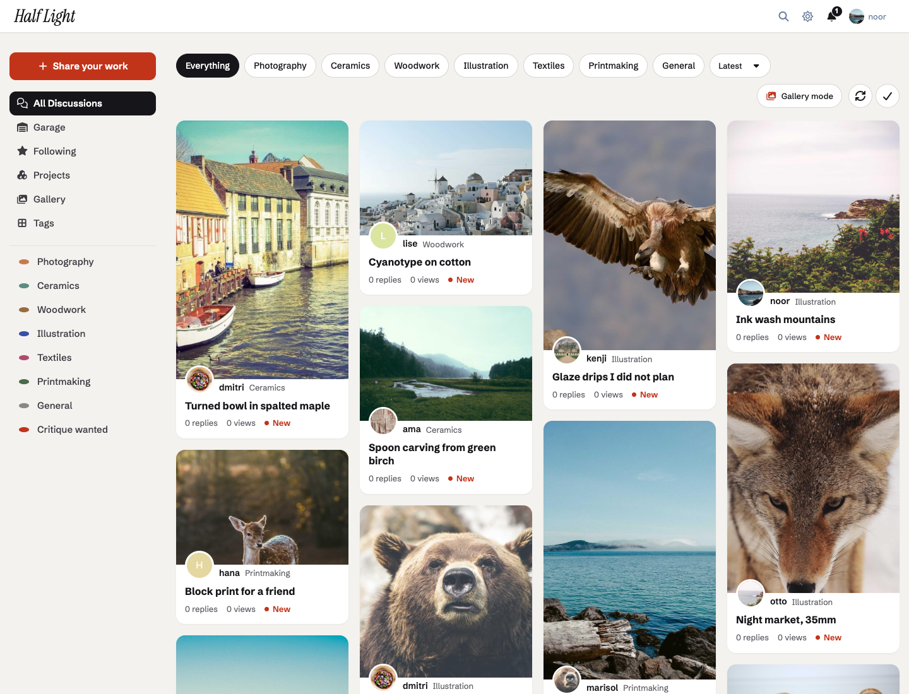
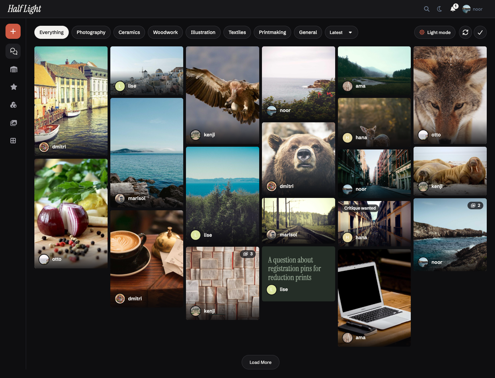
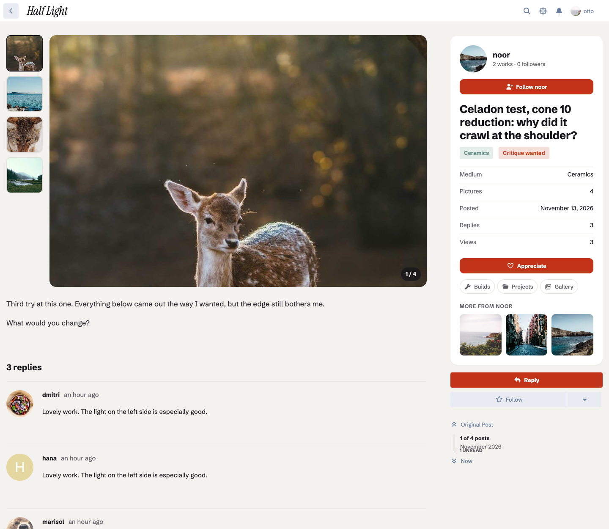
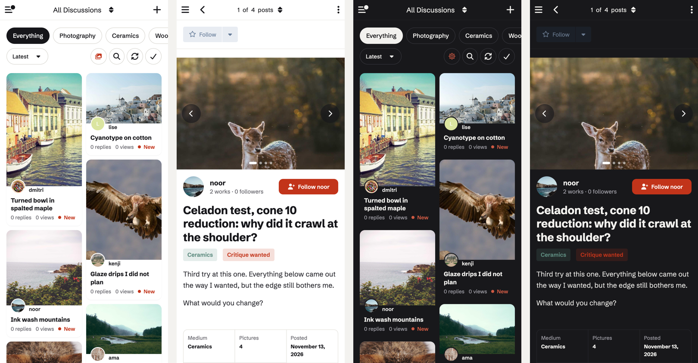

# Studio

**An image-first masonry theme for Flarum 2**, for photo, art and maker
communities. The discussion list becomes a gallery of each discussion's own
pictures, a discussion becomes the work with a card for its maker, and dark
mode becomes a full-bleed gallery.



---

## What it does

- **A masonry gallery.** Every discussion is a card built from the first
  picture in its opening post (Markdown, BBCode or fof/upload), with the
  maker's avatar overlapping it, the title, and the reply count. A discussion
  without a picture becomes a typographic card on its tag's colour.
- **Nothing jumps.** Each card's box is drawn at its picture's shape before
  the picture arrives, so the page doesn't move as pictures load, and
  **Load more** only adds cards: none already on screen moves.
- **Medium chips.** A chip for each primary tag above the gallery, beside
  Flarum's own sort and actions.
- **A member's discussions are their portfolio**: the same gallery on their
  profile.
- **Gallery mode.** In dark mode on wide screens, the page goes edge to edge,
  the sidebar becomes a rail of icons and each card becomes a picture with its
  words over it. A button above the gallery switches modes, saved like
  Flarum's own theme switcher.



## The discussion page

- **A stage** for the opening post's pictures, with thumbnails beside it (dots
  on a phone), arrow keys, and a link to each full-size picture. The stage
  keeps one size while you step through, so the words under it never move.
- **A card for the maker**: their avatar, works and followers, a **Follow**
  button (with [Follow Users](https://github.com/imorland/flarum-ext-follow-users)),
  the title and tags, a **spec sheet** (medium, pictures, date, replies,
  views), **Appreciate** (a like on the opening post, with Flarum's Likes),
  links to the maker's builds, projects and gallery when
  [Garage](https://github.com/ernestdefoe/garage),
  [Projects](https://github.com/ernestdefoe/projects) or Atrium is installed,
  and **More from** the maker.
- **Critique replies** follow under their own heading. On a phone the card is
  split around the post: who made it above the words, the spec sheet below.





## Built on Flarum's own pages

Studio keeps Flarum's page structure, routes and post stream, so extensions
that add to them keep working: the discussion's own hero (title, tags and what
other extensions put there) sits inside the maker's card, and
[fof/forum-widgets-core](https://github.com/FriendsOfFlarum/forum-widgets-core)
widgets show in all five areas. With widgets in the sidebar, gallery mode
keeps the sidebar instead of the rail.

Works with [Wardrobe](https://github.com/ernestdefoe/wardrobe): members can
pick Studio beside your other themes, and visitors on another theme pay
nothing for it.

## How the pictures are found

Each discussion's cover is worked out once, from its opening post's stored
content, and kept on the discussions table (three columns). The first page
that shows a discussion fills every discussion on that page at once: one query
for their opening posts, one for fof/upload's records of the pictures, one
update. A page of 20 costs what a page of 1 does, and once filled Studio adds
no query at all.

- fof/upload pictures use their thumbnail and their stored size.
- Pictures on your own server are measured from the file.
- Pictures hosted elsewhere are measured on the queue (never during a page
  view), reading at most 128 KB from a public address. Without a queue
  worker they use a 4:3 box.
- A picture inside a spoiler, a hidden opening post, or an unapproved one
  never becomes a cover. Editing the opening post works the cover out again.

Moved your uploads to a new host or CDN? `php flarum studio:forget-covers`
works them all out again as they are next seen.

## Settings

Accent color, page background, Studio's fonts (Schibsted Grotesk and
Instrument Serif, served from your forum), dark mode as gallery mode, the
medium chips, the gallery mode button, and reply counts on cards.

## Installation

```sh
composer require ernestdefoe/studio
```

Enable **Studio** in the admin panel. Works on Flarum 2.0 and newer.

### Updating

```sh
composer update ernestdefoe/studio
php flarum migrate
php flarum cache:clear
```

## Links

- [Source](https://github.com/ernestdefoe/studio)
- [Report an issue](https://github.com/ernestdefoe/studio/issues)

Fonts: Schibsted Grotesk and Instrument Serif, SIL Open Font License 1.1
(`assets/fonts`). Studio is MIT licensed.
